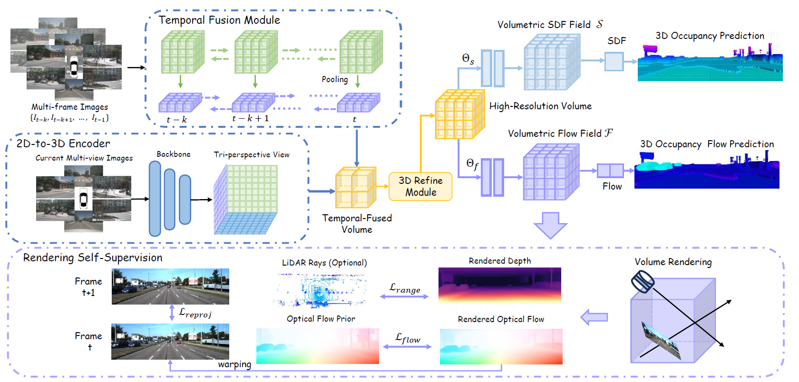

<div align="center">

# Let Occ Flow: Self-Supervised 3D Occupancy Flow Prediction

**CoRL 2024**

[Yili Liu](https://scholar.google.com/citations?user=pBEZ7V4AAAAJ&hl=zh-CN)<sup>\*</sup>, [Linzhan Mou](https://scholar.google.com/citations?user=cIXq7Z4AAAAJ&hl=en)<sup>\*</sup>, [Xuan Yu](https://scholar.google.com/citations?hl=zh-CN&user=4Ry3CKsAAAAJ), Chenrui Han, [Sitong Mao](https://scholar.google.com/citations?user=RiX5SJUAAAAJ&hl=zh-CN&oi=sra), [Rong Xiong](https://scholar.google.com/citations?user=1hI9bqUAAAAJ&hl=en), [Yue Wang](https://ywang-zju.github.io/)<sup>&dagger;</sup>

<sup>\*</sup> Equal contribution &nbsp;&nbsp; <sup>&dagger;</sup> Corresponding author

[](https://arxiv.org/abs/2407.07587)
[](https://eliliu2233.github.io/letoccflow/)
[](https://arxiv.org/abs/2407.07587)

</div>

<p align="center">
  <br>
  <em>Results on KITTI-MOT</em>
</p>

<p align="center">
  <br>
  <em>Results on nuScenes</em>
</p>

## News

- **[2025/04/16]** Training code and pretrained checkpoints are released.
- **[2024/09/04]** Let Occ Flow is accepted to CoRL 2024.
- **[2024/07/18]** The paper is available on [arXiv](https://arxiv.org/abs/2407.07587).

## Overview

<p align="center">
  
</p>

Let Occ Flow is the first self-supervised method that jointly predicts 3D occupancy and occupancy flow. It uses 2D optical flow cues to optimize both geometry and motion. The main contributions are:

- **Temporal fusion.** An attention-based module for efficient interaction across frames.
- **Flow-oriented optimization.** A training strategy that addresses training instability and sample imbalance.
- **Evaluation.** Qualitative and quantitative experiments on multiple datasets show competitive performance.

## Contents

- [Installation](#installation)
- [Data Preparation](#data-preparation)
- [Model Zoo](#model-zoo)
- [Training](#training)
- [Evaluation](#evaluation)
- [Visualization](#visualization)
- [Acknowledgement](#acknowledgement)
- [Citation](#citation)

## Installation

See [docs/installation.md](docs/installation.md).

## Data Preparation

See [docs/prepare_data.md](docs/prepare_data.md) for nuScenes and SemanticKITTI.

## Model Zoo

Put all checkpoints in `ckpts/`.

**Let Occ Flow**

| Checkpoint | Dataset | Model | Download |
| :-- | :-- | :-- | :-: |
| `kitti_odom.pth` | KITTI Odometry | Occupancy (Tab. 1) | [Google Drive](https://drive.google.com/drive/folders/1a9g0tpu57MR7WggvVwq6AI8zfXXfc6ln?usp=sharing) |
| `nuscenes_occ_flow.pth` | nuScenes | Occupancy and occupancy flow (Tab. 3) | [Google Drive](https://drive.google.com/drive/folders/1a9g0tpu57MR7WggvVwq6AI8zfXXfc6ln?usp=sharing) |

**Third-party weights**

| Checkpoint | Model | Required for | Download |
| :-- | :-- | :-- | :-: |
| `convnextB_1kpretrained_official_style.pth` | ConvNeXt-Base backbone | All configs | [Google Drive](https://drive.google.com/file/d/1ZjWbqI1qoBcqeQijI5xX9E-YNkxpJcYV/view) |
| `gmflow-scale2-regrefine6-kitti15-25b554d7.pth` | Unimatch (GMFlow) | KITTI training only | [Link](https://s3.eu-central-1.amazonaws.com/avg-projects/unimatch/pretrained/gmflow-scale2-regrefine6-kitti15-25b554d7.pth) |

## Training

**KITTI Odometry**

```shell
python train.py --py-config config/kitti/kitti_occ_odom.py \
    --work-dir out/train/kitti/occ_odom --dataset kitti --depth-metric
```

**nuScenes.** Training has two stages. Stage 1 learns static occupancy, and stage 2 learns occupancy flow starting from the stage-1 weights.

```shell
# Stage 1: static occupancy
python train.py --py-config config/nuscenes/nuscenes_occ_voxelaffm.py \
    --work-dir out/train/nuscenes/occ_static_train --dataset nuscenes --depth-metric

# Stage 2: occupancy flow (set `load_from` to the stage-1 checkpoint)
python train.py --py-config config/nuscenes/nuscenes_occ_flow_voxelaffm.py \
    --work-dir out/train/nuscenes/occ_flow_train --dataset nuscenes --depth-metric
```

## Evaluation

**1. Export predictions.** Set `load_from` in the config to the checkpoint you want to evaluate. `eval.py` writes occupancy and occupancy flow as `.npz` files to `<work-dir>/occupancy/`.

```shell
# KITTI
python eval.py --py-config config/kitti/kitti_occ_odom.py \
    --work-dir out/visualization/kitti/kitti_odom --resolution 0.2 --dataset kitti

# nuScenes
python eval.py --py-config config/nuscenes/nuscenes_occ_flow_voxelaffm.py \
    --work-dir out/visualization/nuscenes/occ_flow --resolution 0.4 --dataset nuscenes
```

**2. Compute RayIoU.** Ray casting relies on a CUDA extension that is compiled the first time it runs.

```shell
# KITTI
python utils/ray_iou_geo/ray_casting_kitti.py \
    --pred-occ-path out/visualization/kitti/kitti_odom/occupancy --output-dir ray_iou_output/kitti_odom
python utils/ray_iou_geo/metric_kitti.py --work-dir ray_iou_output/kitti_odom

# nuScenes
python utils/ray_iou_geo/ray_casting_nus.py \
    --pred-occ-path out/visualization/nuscenes/occ_flow/occupancy --output-dir ray_iou_output/occ_flow
python utils/ray_iou_geo/metric.py --work-dir ray_iou_output/occ_flow
```

## Visualization

```shell
python visualize_occupancy_kitti.py   # KITTI
python visualize_occupancy.py         # nuScenes
```

Before running, set the input at the top of each script. Use `sequence` and `visual_folder` for KITTI, and `visual_folder` for nuScenes. For nuScenes, `vis_flow = 1` renders occupancy flow instead of occupancy.

## Acknowledgement

This project builds on [SelfOcc](https://github.com/huang-yh/SelfOcc), [OccNeRF](https://github.com/LinShan-Bin/OccNeRF), [OccNet](https://github.com/OpenDriveLab/OccNet), [sdfstudio](https://github.com/autonomousvision/sdfstudio), [Unimatch](https://github.com/autonomousvision/unimatch), and [CoTracker](https://github.com/facebookresearch/co-tracker). We thank the authors for their excellent work.

## Citation

If you find this work useful, please consider citing:

```bibtex
@article{liu2024letoccflow,
    title={Let Occ Flow: Self-Supervised 3D Occupancy Flow Prediction},
    author={Yili Liu and Linzhan Mou and Xuan Yu and Chenrui Han and Sitong Mao and Rong Xiong and Yue Wang},
    journal={arXiv preprint arXiv:2407.07587},
    year={2024},
}
```
